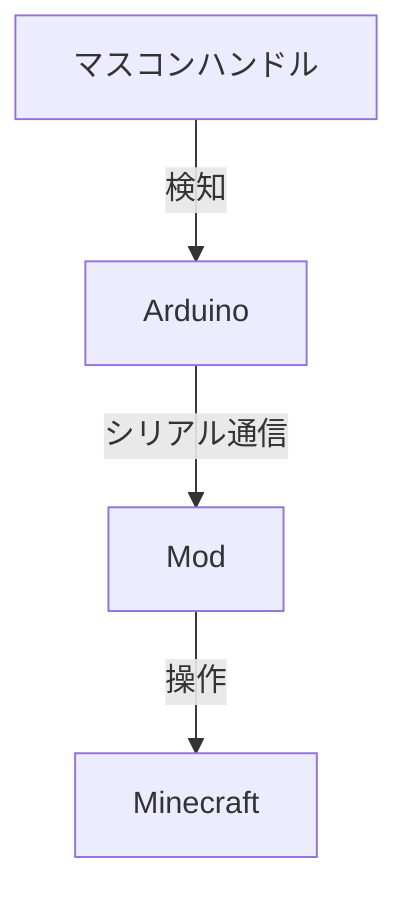

2024/9/23 追記: 非常ブレーキで前進してしまう問題を解決
2024/9/23 追記: 降りた後も前進する問題を解決

普段あるマインクラフトサーバーで遊んでいるのですが、マイクラ内のトロッコを自作マスコンで動かせたらと思いました。
仕組みは以下の通りです（※Arduinoを上手く書けばModを介さなくてもいけるかもしれません）

:::note warn
注意
私はハードウェア開発・ソフトウェア開発共にそれほど上手ではありません。
特にハードウェアに関しては恐ろしく無知です。
:::

## 0. 環境について

### 0.1. ハードウェア

- Arduino UNO (R3...?)

### 0.2. ソフトウェア

- Windows 11 Home 23H2
- Arduino IDE 2.3.2
- Java 21.0.4 (Adopt Eclipse Temurin)
- IntelliJ IDEA 2023.3.6
- Minecraft 1.21
- Fabric Loader 0.16.5

## 1. マスコンハンドルを作る

### 1.1. 回路を作る

可変抵抗とArduinoを接続します
私がハードウェア詳しくない/この方のブログが読みやすい という理由で詳しくは以下の記事を読んでください
ごめんなさい _ _

https://burariweb.info/electronic-work/arduino-learning/arduino-variable-resistor-analog-input.html

### 1.2. 出力する

```c:railway_controler.ino
// 入力ピンを決めておきます
int controlerPin = A5;
int controlerValue = 0;

void setup() {
    // シリアル通信を初期化します。このコードでは速度は9600bpsで設定してます。
    Serial.begin(9600);
}

void loop() {
    // 入力を読み取ります
    controlerValue = analogRead(controlerPin);
    // 値を出力します
    Serial.println(controlerValue);
    // 1ms待機
    delay(1);
}
```

参考:

https://www.arduino.cc/reference/en/language/functions/communication/serial/

https://docs.arduino.cc/tutorials/uno-rev3/AnalogInput/

## 2. Minecraftと通信する

### 2.1. jSerialCommの導入

:::note warn
Arduino IDE のシリアルモニタをつないでると正しく接続できません
(詳しい人にとっては当たり前かもしれませんが、私は躓きました...)
:::

https://fazecast.github.io/jSerialComm/

Javaでシリアル通信をするライブラリがありました。

:::note warn
私はGradle+Kotlinを使用してますが、必要な箇所は書き換えてください
お手数をお掛けします _ _
:::

```kotlin:build.gradle.kts
dependencies {
    // ~省略~

    implementation("com.fazecast:jSerialComm:[2.0.0,3.0.0)")
}
```

これでGradleを再ロードします。

参考:

https://github.com/Fazecast/jSerialComm/wiki/Usage-Examples

### 2.2. 取得して保管する

シリアルポートのオブジェクトを取得します。
`COM6`のところは、おそらくArduino IDEに記載されている名前と同じ番号を書けばいいと思います（本当は`getCommPorts()`ですべてのポートを取得できます。複数台持っている人や余裕がある人は選べるようにする方が望ましいと思います。）

```kotlin:DataStore.kt
//~略~

class DataStore {
    companion object {
        // Mod全体で値にアクセスするためにここで定義
        var controlerval: Int = 0;
    }
}
```

```kotlin:client.ModClient.kt
//~略~

import com.fazecast.jSerialComm.SerialPort
import com.fazecast.jSerialComm.SerialPortDataListener
import com.fazecast.jSerialComm.SerialPortEvent
import net.fabricmc.api.ClientModInitializer
// 先ほどのDataStoreクラスに向けて下さい
import com.ABC.Mod.DataStore

class MacmClient : ClientModInitializer {

    override fun onInitializeClient() {
        // CommPortを取得
        val port = SerialPort.getCommPort("COM6")
        // Arduino側のコードと同じ通信速度に設定
        port.setBaudRate(9600)
        // CommPortを開く
        port.openPort()

        val buffer = StringBuilder()

        port.addDataListener(object : SerialPortDataListener {
            override fun getListeningEvents(): Int {
                return SerialPort.LISTENING_EVENT_DATA_AVAILABLE
            }

            override fun serialEvent(event: SerialPortEvent) {
                if (event.eventType != SerialPort.LISTENING_EVENT_DATA_AVAILABLE) return
                val newData = ByteArray(port.bytesAvailable())
                val numRead = port.readBytes(newData, newData.size)
                buffer.append(String(newData, 0, numRead))

                // バッファ 行ごとに処理します
                var lineEndIndex: Int
                while (buffer.indexOf("\n").also { lineEndIndex = it } != -1) {
                    val line = buffer.substring(0, lineEndIndex).trim()
                    buffer.delete(0, lineEndIndex + 1)
                    DataStore.controlerval = line.toInt()
                }
            }
        })
    }
}
```

これで取得ができました。

### 2.3. 力行・制動の設定

そうでした、それぞれの範囲も決めないといけませんね

※ここからはMixinを使用するため、Javaコードとなります。

あなたの可変抵抗器に合う数値で調節して下さい

```java
String getPowerID(Integer value) {
    if (value > 935) {
        return "EB";
    } else if (value > 857) {
        return "B7";
    } else if (value > 779) {
        return "B6";
    } else if (value > 701) {
        return "B5";
    } else if (value > 623) {
        return "B4";
    } else if (value > 545) {
        return "B3";
    } else if (value > 467) {
        return "B2";
    } else if (value > 389) {
        return "B1";
    } else if (value > 311) {
        return "N";
    } else if (value > 233) {
        return "P1";
    } else if (value > 155) {
        return "P2";
    } else if (value > 77) {
        return "P3";
    } else {
        return "P4";
    }
}
```

### 2.4. 操作部分

次に自動操作部を作ります。
マイクラにはアクセル・ブレーキがWかSしかないためどのようにマスコンでスピードを操作するか悩みました。
結果、点滅の間隔で速度を調節する事にしました。

(例)

| 力行 | ティック | 制動 | ティック |
| --- | ------- | ---- | ------- |
| P1  | 4tick   | B1   | 20tick  |
| P2  | 2tick   | B2   | 16tick  |
| P3  | 1tick   | B3   | 12tick  |
| P4  | 0tick   | B4   | 8tick   |
|     |         | B5   | 4tick   |
|     |         | B6   | 2tick   |
|     |         | B7   | 1tick   |
|     |         | EB   | 0tick   |

```java
private int getWaittick(String powerID) {
    if (powerID.equals("EB")) {
        return 0;
    } else if (powerID.equals("B7")) {
        return 1;
    } else if (powerID.equals("B6")) {
        return 2;
    } else if (powerID.equals("B5")) {
        return 4;
    } else if (powerID.equals("B4")) {
        return 8;
    } else if (powerID.equals("B3")) {
        return 12;
    } else if (powerID.equals("B2")) {
        return 16;
    } else if (powerID.equals("B1")) {
        return 20;
    } else if (powerID.equals("N")) {
        return 0;
    } else if (powerID.equals("P1")) {
        return 4;
    } else if (powerID.equals("P2")) {
        return 2;
    } else if (powerID.equals("P3")) {
        return 1;
    } else {
        return 0;
    }
}
```

### 2.5. メイン

先ほどのコード等を使用して動作部分を書いていきます

```json:resources/mod.mixins.json
{
    // ~略~
    "client": [
        "TrainControlerMixin"
    ],
    // ~略~
}
```

```java:mixin.TrainControlerMixin.java
// ~略~

// DataStoreクラスに向けて下さい
import com.ABC.Mod.DataStore;

import net.minecraft.client.MinecraftClient;
import net.minecraft.entity.player.PlayerEntity;
import net.minecraft.entity.vehicle.MinecartEntity;
import org.spongepowered.asm.mixin.Mixin;
import org.spongepowered.asm.mixin.Unique;
import org.spongepowered.asm.mixin.injection.At;
import org.spongepowered.asm.mixin.injection.Inject;
import org.spongepowered.asm.mixin.injection.callback.CallbackInfo;

@Mixin(PlayerEntity.class)
public class TrainControlerMixin {

    // 2.3.のコード
    @Unique
    private String getPowerID(Integer value) {
        if (value > 935) {
            return "EB";
        } else if (value > 857) {
            return "B7";
        } else if (value > 779) {
            return "B6";
        } else if (value > 701) {
            return "B5";
        } else if (value > 623) {
            return "B4";
        } else if (value > 545) {
            return "B3";
        } else if (value > 467) {
            return "B2";
        } else if (value > 389) {
            return "B1";
        } else if (value > 311) {
            return "N";
        } else if (value > 233) {
            return "P1";
        } else if (value > 155) {
            return "P2";
        } else if (value > 77) {
            return "P3";
        } else {
            return "P4";
        }
    }

    // 2.4.のコード
    @Unique
    private int getWaittick(String powerID) {
        if (powerID.equals("EB")) {
            return 0;
        } else if (powerID.equals("B7")) {
            return 1;
        } else if (powerID.equals("B6")) {
            return 2;
        } else if (powerID.equals("B5")) {
            return 4;
        } else if (powerID.equals("B4")) {
            return 8;
        } else if (powerID.equals("B3")) {
            return 12;
        } else if (powerID.equals("B2")) {
            return 16;
        } else if (powerID.equals("B1")) {
            return 20;
        } else if (powerID.equals("N")) {
            return 0;
        } else if (powerID.equals("P1")) {
            return 4;
        } else if (powerID.equals("P2")) {
            return 2;
        } else if (powerID.equals("P3")) {
            return 1;
        } else {
            return 0;
        }
    }

    // 待機ティック数
    @Unique
    private int waittick = 0;

    // 前ティックのID
    @Unique
    private String previousPowerID = "";

    @Unique
    private boolean isRiding = false;

    // 毎ティックごとに
    @Inject(method = "tick", at = @At("HEAD"))
    private void onTick(CallbackInfo ci) {

        MinecraftClient client = MinecraftClient.getInstance();
        String powerID = getPowerID(DataStore.Companion.getControlerval());
        if (client == null) return;

        var player = client.player;
        if (player == null) return;

        // トロッコに乗っているなら
        if(player.getVehicle() instanceof MinecartEntity) {
            isRiding = true;

            // 前ティックとIDが異なるなら
            if (!previousPowerID.equals(powerID)) {
                // 経過ティックをリセットする
                previousPowerID = powerID;
                waittick = 0;
            }

            // 惰行なら
            if (powerID.equals("N")) {
                // 解放
                client.options.forwardKey.setPressed(false);
                client.options.backKey.setPressed(false);
            // ティックが0を下回ったら
            } else if (waittick <= 0) {
                // 制動なら後退キーを押して前進キーを開放
                if (powerID.startsWith("B") || powerID.startsMith("E")) {
                    client.options.backKey.setPressed(true);
                    client.options.forwardKey.setPressed(false);
                // 力行なら前進キーを押して後退キーを開放
                } else {
                    client.options.forwardKey.setPressed(true);
                    client.options.backKey.setPressed(false);
                }

                // ティックをリセット
                waittick = getWaittick(powerID);
            // ティックが自然数なら
            } else {
                // 継続
                waittick--;
            }
        } else {
            if (isRiding) {
            client.options.forwardKey.setPressed(false);
                client.options.backKey.setPressed(false);
                isRiding = false;
            }
        }
    }
}
```

## 3. 完成

### 3.1. ソースコード

https://github.com/fhrk-78/MinecraftArduinoControlerForMinecart

※リポジトリはCOM6でプッシュされているので注意してください

### 3.2. 今後更新していきたいこと

- コンピュータを自由に指定できるようにする
- レバーサーの対応

最後まで読んで頂きありがとうございました
